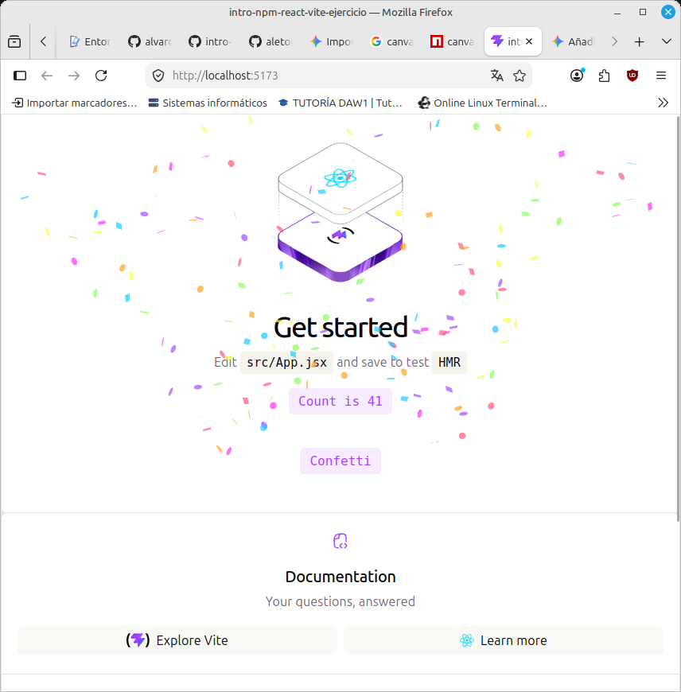
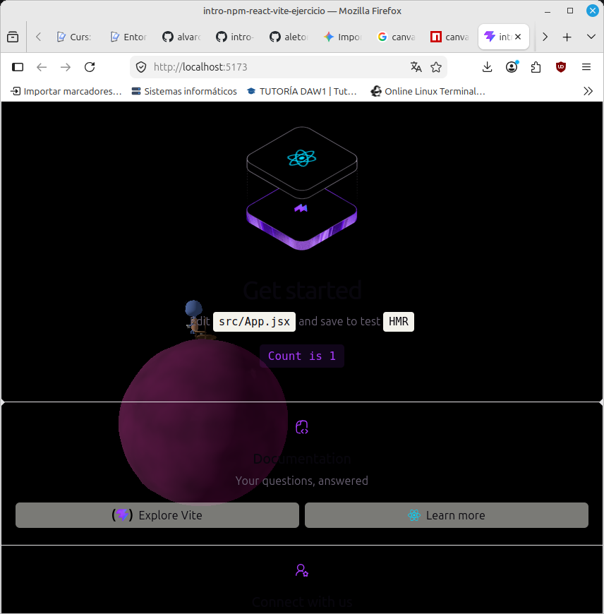

# Ejercicio React
Este es un proyecto que explica brevemente un stack de trabajo para hacer un proyecto en react:

    npm para gestionar dependencias y hacer la build
    vite para iniciar el proyecto y el servidor
    react como framework usado

## Dependencia React-Confetti

 

## Dependencia Canvas-Confetti

 

## Dependencia React-Three-Fiber para renderizado 3D

 

Si la carpeta node_modules/ está excluida, ¿borrar una dependencia hace alguna acción sobre el repositorio? ¿Cuál?

